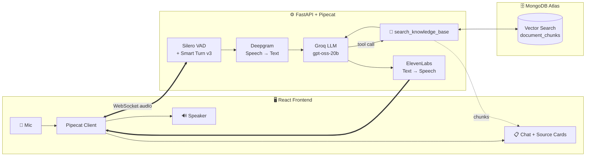
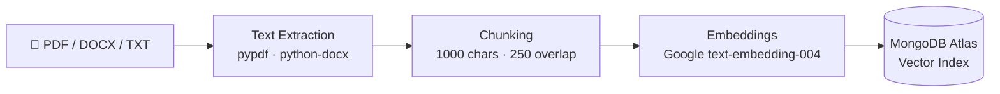
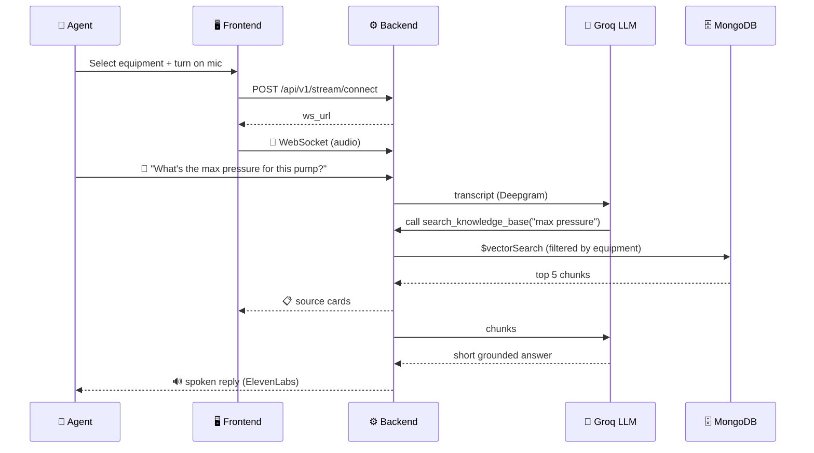
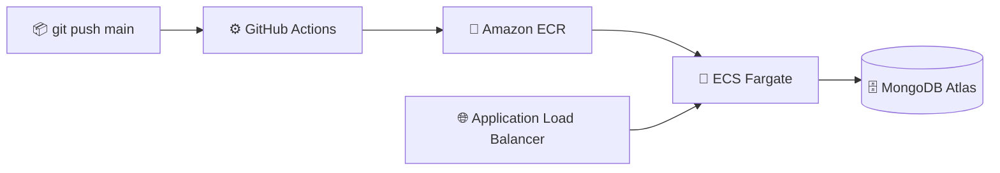

<div align="center">

# 🎙️ AI Voice Agent

### Real-time voice copilot for call-center agents, powered by RAG

*Speak a question → the bot searches your equipment manuals → it answers back in under 30 words.*

<br/>


<br/>

[✨ Features](#-features) •
[🏗️ Architecture](#️-architecture) •
[🧰 Tech Stack](#-tech-stack) •
[🚀 Quick Start](#-quick-start) •
[📡 API](#-api-reference) •
[☁️ Deploy](#️-deploy-to-aws)

</div>

---

## 💡 What is this?

Call-center agents can't flip through a 200-page machine manual while a customer waits on the line.
**AI Voice Agent** listens to the conversation, pulls the right facts from that equipment's documents, and **speaks a short, grounded answer** straight to the agent, in real time.

> 🧠 **No guessing.** The bot answers only from your uploaded knowledge base. If the docs don't have it, it tells the agent to ask the customer for clarification.

<br/>

## ✨ Features

| | Feature | Details |
|---|---|---|
| 🎤 | **Real-time voice** | Full-duplex audio over WebSocket with natural turn-taking |
| 🗣️ | **Smart turn detection** | Silero VAD + Pipecat Smart Turn v3 know when you've *actually* finished speaking |
| 📚 | **Per-equipment RAG** | Every machine has its own knowledge base; search is filtered by `equipment_id` and `tenant_id` |
| 📄 | **Drop-in documents** | Upload `.pdf`, `.docx`, `.txt`, `.md`; text is chunked, embedded and indexed automatically |
| 🛠️ | **LLM tool calling** | The model decides when to call `search_knowledge_base` |
| 🔍 | **See the sources** | Retrieved chunks stream to the UI as cards, so the agent can verify every answer |
| ⚡ | **Built for speed** | Groq inference + 1-sentence answers tuned for speech |
| 🏢 | **Multi-tenant ready** | Tenant-scoped data model from day one |
| ☁️ | **One-push deploy** | GitHub Actions → ECR → ECS Fargate behind an Application Load Balancer |

<br/>

## 🏗️ Architecture



### 📥 Document ingestion



### 🔁 One conversation turn



<br/>

## 🧰 Tech Stack

<table>
<tr>
<td valign="top" width="50%">

**⚙️ Backend**
- Python 3.12 · **FastAPI** · Uvicorn
- **Pipecat** voice pipeline
- `uv` for dependency management
- Motor (async MongoDB driver)
- LangChain text splitters
- Loguru logging

</td>
<td valign="top" width="50%">

**🖥️ Frontend**
- **React 18** + **Vite** + TypeScript
- Tailwind CSS
- `@pipecat-ai/client-react`
- `@pipecat-ai/websocket-transport`
- Lucide icons · Axios

</td>
</tr>
<tr>
<td valign="top">

**🤖 AI Services**
- 🗣️ **Deepgram**: speech-to-text
- 🧠 **Groq**: LLM inference (`openai/gpt-oss-20b`)
- 🔊 **ElevenLabs**: text-to-speech
- 🧬 **Google Gemini**: embeddings

</td>
<td valign="top">

**☁️ Infra**
- 🐳 Docker + Docker Compose
- 🗄️ MongoDB Atlas Vector Search
- AWS **ECS Fargate**, **ECR**, **ALB**, VPC
- CloudFormation (IaC)
- GitHub Actions CI/CD

</td>
</tr>
</table>

<br/>

## 📁 Project Structure

```
ai-voice-agent/
├── 🐍 backend/
│   ├── main.py                  # FastAPI app, CORS, routers
│   └── app/
│       ├── bot.py               # 🎙️ Pipecat pipeline: STT → LLM → TTS
│       ├── config.py            # Settings from .env
│       ├── database.py          # MongoDB connection
│       ├── routers/
│       │   ├── equipment.py     # Equipment CRUD + document upload
│       │   └── stream.py        # /connect + WebSocket endpoint
│       ├── services/
│       │   ├── rag.py           # 🔎 Vector search retrieval
│       │   ├── embeddings.py    # Chunking + Gemini embeddings
│       │   └── text_extraction.py
│       └── models/              # Pydantic models
├── ⚛️ frontend/
│   └── src/
│       ├── pages/Stream.tsx     # Pipecat client provider
│       ├── components/          # Chat panel, bubbles, source cards
│       └── hooks/               # Pipecat chat events
├── ☁️ infrastructure/           # CloudFormation + setup/destroy scripts
├── 🛠️ scripts/                  # ECR build/push, ECS deploy
├── 🔄 .github/workflows/        # CI/CD to AWS
├── 🐳 docker-compose.yml
├── 📘 DEPLOYMENT.md
└── 🎨 flow.excalidraw           # Architecture sketch
```

<br/>

## 🚀 Quick Start

### ✅ Prerequisites

- 🐳 [Docker Desktop](https://www.docker.com/products/docker-desktop/)
- 🗄️ A [MongoDB Atlas](https://www.mongodb.com/atlas) cluster
- 🔑 API keys: [Deepgram](https://console.deepgram.com/) · [Groq](https://console.groq.com/) · [ElevenLabs](https://elevenlabs.io/) · [Google AI Studio](https://aistudio.google.com/)

### 1️⃣ Clone

```bash
git clone https://github.com/naveentheog/ai-voice-agent.git
cd ai-voice-agent
```

### 2️⃣ Configure `backend/.env`

```env
# 🗄️ Database
MONGO_URL=mongodb+srv://<user>:<password>@<cluster>.mongodb.net
DB_NAME=rag_voice_agent_db

# 🔑 API keys
DEEPGRAM_API_KEY=your_key
GROQ_API_KEY=your_key
GOOGLE_API_KEY=your_key
ELEVENLABS_API_KEY=your_key

# 🎛️ Optional
ELEVENLABS_VOICE_ID=pNInz6obpgDQGcFmaJgB
GROQ_MODEL=openai/gpt-oss-20b
```

### 3️⃣ Create the Atlas vector index

In Atlas → **Search & Vector Search**, create an index named **`vector_index`** on the `document_chunks` collection:

```json
{
  "fields": [
    { "type": "vector", "path": "embedding", "numDimensions": 768, "similarity": "cosine" },
    { "type": "filter", "path": "equipment_id" },
    { "type": "filter", "path": "tenant_id" },
    { "type": "filter", "path": "is_disabled" }
  ]
}
```

### 4️⃣ Run it

```bash
docker-compose up --build
```

| Service | URL |
|---|---|
| 🖥️ Frontend | http://localhost:3000 |
| ⚙️ Backend API | http://localhost:8000 |
| 📖 Swagger docs | http://localhost:8000/docs |

### 5️⃣ Add knowledge and talk 🎉

```bash
# Create an equipment
curl -X POST http://localhost:8000/api/v1/equipment/ \
  -H "Content-Type: application/json" \
  -d '{"name": "Hydraulic Pump X200", "description": "Industrial hydraulic pump", "tenant_id": "mvp_tenant"}'

# Upload its manual (use the _id returned above)
curl -X POST http://localhost:8000/api/v1/equipment/<equipment_id>/documents \
  -F "files=@pump_manual.pdf"
```

Open the frontend, pick the equipment, switch on the mic, and start asking. 🎤

<details>
<summary>🧑‍💻 <b>Run without Docker</b></summary>

```bash
# Backend
cd backend
uv sync
uv run uvicorn main:app --reload --port 8000

# Frontend (new terminal)
cd frontend
npm install
echo "VITE_API_BASE_URL=http://localhost:8000/api/v1" > .env
npm run dev
```

</details>

<br/>

## 📡 API Reference

Base URL: `/api/v1`

| Method | Endpoint | Description |
|:---:|---|---|
|  | `/equipment/` | Create an equipment |
|  | `/equipment/` | List all equipment |
|  | `/equipment/{id}` | Get one equipment |
|  | `/equipment/{id}/documents` | Upload docs (multipart, multiple files) |
|  | `/equipment/{id}/documents` | List an equipment's docs |
|  | `/stream/connect` | Get the WebSocket URL for a voice session |
|  | `/stream/ws/{equipment_id}` | Real-time voice stream |
|  | `/health` | Health check |

<br/>

## ⚙️ Configuration

| Variable | Default | Purpose |
|---|---|---|
| `MONGO_URL` | — | MongoDB Atlas connection string |
| `DB_NAME` | `live_db` | Database name |
| `GROQ_MODEL` | `openai/gpt-oss-20b` | LLM used for answers |
| `EMBEDDING_MODEL` | `models/text-embedding-004` | Embedding model |
| `CHUNK_SIZE` / `CHUNK_OVERLAP` | `1000` / `250` | Text splitting |
| `VECTOR_INDEX_NAME` | `vector_index` | Atlas vector index |
| `ELEVENLABS_VOICE_ID` | `pNInz6obpgDQGcFmaJgB` | TTS voice |
| `ALLOWED_ORIGINS` | — | Comma-separated CORS origins (production) |
| `ENVIRONMENT` | — | Set to `production` to enforce CORS |

<br/>

## ☁️ Deploy to AWS



Every push to `main` builds both images, pushes them to ECR and rolls out new ECS tasks.
Full step-by-step guide, including CloudFormation setup and secrets: **[📘 DEPLOYMENT.md](./DEPLOYMENT.md)**

<br/>

## 🗺️ Roadmap

- [ ] 🔐 Authentication & real multi-tenant users
- [ ] ⚡ Batch + async embeddings for faster uploads
- [ ] 🪣 Store original files in S3
- [ ] 🌐 Multilingual support (Hindi, Tamil, …)
- [ ] 📊 Call analytics & answer-quality dashboard
- [ ] 🧪 Test suite + evals for retrieval quality

<br/>

## 🤝 Contributing

Ideas, issues and PRs are welcome!

1. 🍴 Fork the repo
2. 🌿 Create a branch: `git checkout -b feature/amazing-idea`
3. 💾 Commit: `git commit -m "Add amazing idea"`
4. 🚀 Push and open a Pull Request

<br/>

---

<div align="center">

### 👨‍💻 Built by [Naveen](https://github.com/naveentheog)

If this project helped you, drop a ⭐. It keeps me building!

</div>
